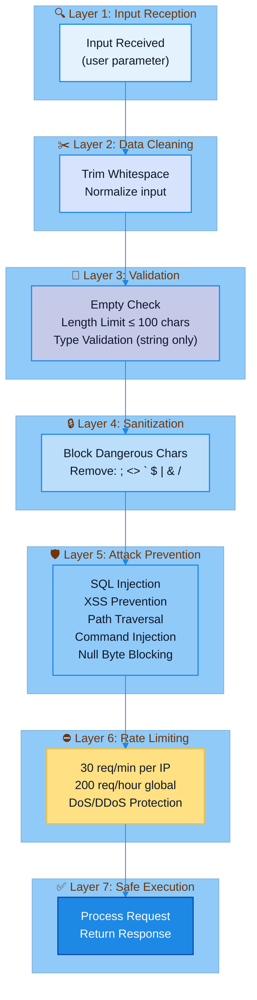

# Security

MSN Weather Wrapper implements comprehensive security measures to protect against common web vulnerabilities and attacks.

## Reporting Security Issues

If you discover a security vulnerability, please report it privately to:
- **Email**: the.jim.wyatt@outlook.com
- **Subject**: [SECURITY] MSN Weather Wrapper - Brief Description

Please do not open public issues for security vulnerabilities.

## Security Features

### Input Validation
- **Character Filtering**: Blocks dangerous characters (`;`, `<>`, `` ` ``, `$`, `|`, `&`, `/\`)
- **Length Limits**: 100 character maximum for city and country names
- **Type Checking**: Enforces string types, rejects integers/booleans/arrays
- **Whitespace Handling**: Trims and rejects empty/whitespace-only inputs

### Security Defense Layers



### Attack Prevention

| Attack Type | Protection | Status |
|------------|------------|--------|
| SQL Injection | Blocks SQL keywords and syntax | ✅ Blocked |
| XSS (Cross-Site Scripting) | Blocks HTML/JavaScript tags | ✅ Blocked |
| Path Traversal | Blocks directory traversal patterns | ✅ Blocked |
| Command Injection | Blocks shell command syntax | ✅ Blocked |
| Null Byte Injection | Blocks null characters | ✅ Blocked |
| Buffer Overflow | Enforces input length limits | ✅ Blocked |
| Type Confusion | Validates data types | ✅ Blocked |

### Rate Limiting
- **Per IP**: 30 requests per minute (all endpoints)
- **Global Limit**: 200 requests per hour total
- **Protection**: DoS and DDoS mitigation

## Security Testing

### Automated Security Scanning

The project uses a **comprehensive security scanning workflow** integrated into CI/CD:

**SAST (Static Application Security Testing):**
- **Bandit**: Detects hardcoded passwords, insecure patterns, common security issues
- **Semgrep**: Advanced pattern-based SAST with community security rules

**Dependency Vulnerability Scanning:**
- **pip-audit**: Vulnerability checking of installed dependencies

**Container Security:**
- **Trivy**: Multi-layer container image vulnerability scanning with SARIF upload to GitHub Security (main branch and tags only)
- **Grype**: SBOM-based vulnerability detection and analysis (main branch and tags only)

**License Compliance:**
- **pip-licenses**: Dependency license report on all branches

**Execution Strategy:**
- **Pull Requests**: Basic security checks (Bandit, Semgrep, pip-audit, pip-licenses) - fast feedback
- **Main Branch & Tags**: Basic checks plus container scanning (Trivy, Grype) - complete validation
- **Manual Trigger**: On-demand runs via workflow dispatch of `ci.yml`

**Artifact Management:**
- 3-day retention for the `security-reports` artifact (not uploaded on PRs)
- 30-day retention for the `container-security-reports` artifact
- Trivy results uploaded to GitHub Security tab
- Automated markdown reports generated for documentation site

**CI/CD Integration:**
- Basic security checks run on every PR (fast)
- Container scans on main branch and tags (thorough)
- Trivy results uploaded to GitHub Security tab with SARIF format
- Automated reports generated in docs/reports/security-report.md

### Test Coverage
- **Security Tests**: `tests/test_security.py`
- **Fuzzing Coverage**: Common attack payloads tested
- **Code Coverage**: Includes security validation paths
- **Integration Tests**: Security validation on live API
- **Security Tools**: Coverage across SAST, dependencies, and containers

### Test Methodology
1. **Unit Tests**: Validate input sanitization logic
2. **Integration Tests**: Test security on live API endpoints
3. **Fuzzing**: Test with malicious payloads
4. **Rate Limit Tests**: Verify DoS protection

### Example Security Tests

**SQL Injection Attempts:**
```bash
# Test 1: Classic SQL injection
curl "http://localhost:5000/api/v1/weather?city='; DROP TABLE users--&country=USA"
# Response: {"error": "Invalid input", "message": "city contains invalid characters"}

# Test 2: UNION-based injection
curl "http://localhost:5000/api/v1/weather?city=1' UNION SELECT * FROM users--&country=USA"
# Response: {"error": "Invalid input", "message": "city contains invalid characters"}
```

**XSS Attempts:**
```bash
# Test 1: Script tag injection
curl "http://localhost:5000/api/v1/weather?city=<script>alert('xss')</script>&country=USA"
# Response: {"error": "Invalid input", "message": "city contains invalid characters"}

# Test 2: JavaScript protocol
curl "http://localhost:5000/api/v1/weather?city=javascript:alert(1)&country=USA"
# Response: {"error": "Invalid input", "message": "city contains invalid characters"}
```

**Path Traversal Attempts:**
```bash
# Test 1: Directory traversal
curl "http://localhost:5000/api/v1/weather?city=../../../etc/passwd&country=USA"
# Response: {"error": "Invalid input", "message": "city contains invalid characters"}

# Test 2: Encoded traversal
curl "http://localhost:5000/api/v1/weather?city=..%2F..%2Fetc%2Fpasswd&country=USA"
# Response: {"error": "Invalid input", "message": "city contains invalid characters"}
```

**Command Injection Attempts:**
```bash
# Test 1: Shell command
curl "http://localhost:5000/api/v1/weather?city=Seattle; cat /etc/passwd&country=USA"
# Response: {"error": "Invalid input", "message": "city contains invalid characters"}

# Test 2: Pipe command
curl "http://localhost:5000/api/v1/weather?city=Seattle | whoami&country=USA"
# Response: {"error": "Invalid input", "message": "city contains invalid characters"}
```

## Security Best Practices

### For Developers
1. **Never disable input validation** - All user inputs must pass through sanitization
2. **Use parameterized queries** - Although we don't use SQL directly, maintain safe practices
3. **Keep dependencies updated** - Regularly update all dependencies
4. **Run security tests** - Execute `pytest tests/test_security.py` before each release
5. **Review security scans** - Run Bandit and pip-audit tools regularly

### For Deployment
1. **Use HTTPS** - Always deploy with TLS/SSL in production
2. **Set secure headers** - Configure CSP, X-Frame-Options, etc.
3. **Configure rate limiting** - Adjust limits based on expected traffic
4. **Monitor logs** - Watch for suspicious patterns
5. **Keep secrets safe** - Use environment variables for sensitive data

### For Users
1. **Use official sources** - Only download from official repositories
2. **Verify checksums** - Check SBOM and package integrity
3. **Report vulnerabilities** - Use responsible disclosure
4. **Keep updated** - Use latest stable versions

## Vulnerability Reporting

If you discover a security vulnerability:

1. **Do NOT** open a public issue
2. Email security concerns to: the.jim.wyatt@outlook.com
3. Include:
   - Description of the vulnerability
   - Steps to reproduce
   - Potential impact
   - Suggested fix (if any)
4. Allow 90 days for responsible disclosure

## Security Audit History

### December 2025
- ✅ Comprehensive security test suite added
- ✅ Input validation hardened
- ✅ Rate limiting implemented
- ✅ Security documentation completed
- ✅ All security tests passing
- ✅ High code coverage achieved

## Security Tools Integration

### Static Analysis
```bash
# Run Bandit security scanner
bandit -r backend/

# Run pip-audit dependency checker
pip-audit
```

### Dynamic Testing
```bash
# Run security test suite
pytest tests/test_security.py -v

# Run all tests including security
pytest --cov=backend --cov-report=html
```

### SBOM Generation
```bash
# Generate Software Bill of Materials
./scripts/generate_sbom.sh

# View SBOM summary
cat sbom_output/SBOM_SUMMARY_*.md
```

## Compliance

### Standards
- ✅ OWASP Top 10 protections
- ✅ CWE Common Weakness Enumeration coverage
- ✅ NIST security guidelines

### Certifications
- MIT Licensed open source
- No known CVEs
- Regular security updates

## Security Checklist

Before each release:
- [ ] All security tests passing
- [ ] No new security warnings from Bandit
- [ ] All dependencies checked with pip-audit
- [ ] SBOM generated and verified
- [ ] Security documentation updated
- [ ] Rate limits configured appropriately
- [ ] Input validation reviewed
- [ ] No hardcoded secrets or credentials

## References

- [OWASP Top 10](https://owasp.org/www-project-top-ten/)
- [CWE Top 25](https://cwe.mitre.org/top25/)
- [FastAPI Security](https://fastapi.tiangolo.com/tutorial/security/)
- [Pydantic Validation](https://docs.pydantic.dev/)
