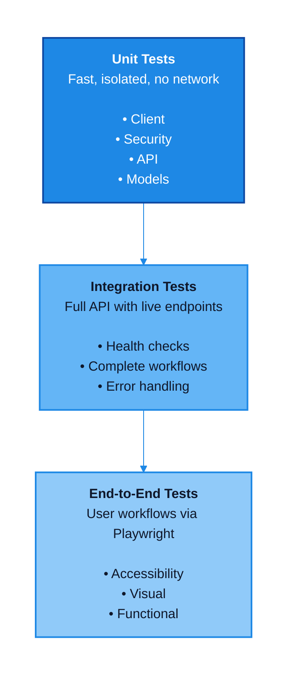

# Testing Guide

Complete testing documentation for MSN Weather Wrapper, including test coverage, methodologies, and execution.

## Test Pyramid



## Test Suite Overview

| Category | Location | Runs in CI |
| ---------- | ------- | -------- |
| **Backend Unit Tests** | `tests/test_client.py`, `tests/test_models.py`, `tests/test_api.py` | ✅ `test.yml` |
| **Security Tests** | `tests/test_security.py` | ✅ `test.yml` |
| **Integration Tests** | `tests/test_integration.py` | ✅ `test.yml` (against the built container) |
| **Benchmarks** | `tests/test_benchmarks.py` | ✅ `performance.yml` (main branch) |
| **Frontend E2E Tests** | `frontend/tests/e2e/` | ❌ Run locally or in containers |

Current test counts, results, and coverage figures are published in the CI-generated [Test Report](reports/test-report.md) and [Coverage Report](reports/coverage-report.md).

### Backend Coverage Breakdown

- **Client Tests**: weather data, parsing, conversions, geolocation
- **API Tests**: endpoints, validation, caching, health checks, coordinates, recent searches
- **Models Tests**: Pydantic validation
- **Security Tests**: input validation, attack prevention, rate limiting
- **Coverage**: measured over the `backend` package (`--cov=backend`)

### Frontend Test Coverage

- **End-to-End Tests**: Playwright
- **Accessibility Tests**: WCAG 2.1 Level AA compliance
- **Visual Regression Tests**: Multiple viewports and states
- **Functional Tests**: Weather search, autocomplete, unit toggle, recent searches
- **Tool**: Playwright with @axe-core/playwright

## Quick Start

### Backend Tests

#### Run All Tests

```bash
pytest
```

The default options in `pyproject.toml` deselect tests marked `integration` and collect coverage for `backend`.

#### Run Specific Test Categories

```bash

# Unit tests only (fast, no network)

pytest tests/test_client.py tests/test_models.py tests/test_api.py

# Security tests

pytest tests/test_security.py -v

# Cache tests

pytest tests/test_api.py -k cache -v

# Integration tests (requires the app container on http://localhost:8080)

export APP_SECRET_KEY="$(python3 -c 'import secrets; print(secrets.token_hex(32))')"  # required by the production compose file
podman-compose -f infra/compose/podman-compose.yml up -d
pytest tests/test_integration.py -v --override-ini="addopts="
```

#### With Coverage

```bash

# Generate coverage report

pytest --cov=backend --cov-report=html

# View report

open htmlcov/index.html  # macOS
xdg-open htmlcov/index.html  # Linux
```

### Frontend Tests

Frontend E2E tests require Node.js 24+ (project standard) and run in a containerized environment.

#### Containerized Testing

```bash

# Build Playwright container

podman build -f infra/containers/Containerfile.playwright -t msn-weather-playwright:latest .

# Start frontend server

podman network create test-net
podman run -d --name frontend-srv --network test-net -p 3000:3000 \
  -v ./frontend:/app:Z node:24-trixie-slim sh -c "cd /app && npm install && npm run dev -- --hostname 0.0.0.0"

# Run tests

podman run --rm --network test-net \
  -e PLAYWRIGHT_BASE_URL=http://frontend-srv:3000 \
  msn-weather-playwright:latest npx playwright test
```

### Test Breakdown

### Backend Tests

#### Client Tests

- Weather data fetching
- Error handling
- HTTP request validation
- Response parsing
- Cache functionality
- Geolocation support

#### Security Tests

- SQL injection prevention
- XSS attack prevention
- Path traversal protection
- Command injection prevention
- Rate limiting validation
- Input sanitization

#### Model Tests

- Pydantic model validation
- Data type enforcement
- Required fields
- Optional fields

#### API Tests

- Health check endpoints (`/api/v1/health`, `/api/v1/health/live`, `/api/v1/health/ready`)
- GET request handling
- POST request handling
- Error responses
- CORS configuration

### Security Test Matrix

#### Input Validation (`TestInputValidation`)

- ✅ Valid input accepted
- ✅ Whitespace trimming
- ✅ Empty string rejection
- ✅ `None` rejection
- ✅ Whitespace-only rejection
- ✅ Length limit enforcement
- ✅ Non-string type rejection
- ✅ Special character rejection
- ✅ Unicode city names allowed

#### GET Request Security (`TestAPISecurityGET`)

- ✅ SQL injection attempts
- ✅ XSS attempts
- ✅ Path traversal attempts
- ✅ Command injection attempts
- ✅ Null bytes
- ✅ Oversized input
- ✅ Empty parameters
- ✅ Whitespace-only parameters

#### POST Request Security (`TestAPISecurityPOST`)

- ✅ Malformed JSON
- ✅ Non-string types
- ✅ SQL injection in JSON
- ✅ XSS in JSON
- ✅ Non-object JSON bodies
- ✅ Oversized JSON values

#### HTTP Error Handlers (`TestHTTPErrorHandlers`)

- ✅ 404 Not Found handling
- ✅ 405 Method Not Allowed handling
- ✅ 413 Payload Too Large handling
- ✅ 400 Bad Request for missing required fields
- ✅ 415 Unsupported Media Type handling
- ✅ Invalid JSON syntax
- ✅ Content-Type without charset
- ✅ Empty POST body
- ✅ Null bytes in input
- ✅ Very long query strings
- ✅ Unicode normalization attacks
- ✅ Header injection attempts
- ✅ Multiple content types
- ✅ Case-sensitive endpoints
- ✅ Trailing slash handling
- ✅ Double slashes in path
- ✅ URL encoding in parameters
- ✅ Repeated parameters
- ✅ Parameters without values
- ✅ CORS preflight requests
- ✅ Response headers present

#### Rate Limiting (`TestAPIRateLimiting`)

- ✅ Multiple valid requests
- ✅ Multiple invalid requests

### Cache Tests

Located in `tests/test_api.py`:

- ✅ Cache hits within the same time bucket
- ✅ Cache invalidation across time buckets
- ✅ Separate cache entries for different locations
- ✅ Cache size configuration
- ✅ Cache duration configuration
- ✅ Zero cache duration

### Integration Tests

Run against the unified container on `http://localhost:8080` (`tests/test_integration.py`).

#### API Functionality

- Health check endpoint
- GET weather endpoint (missing and valid parameters)
- POST weather endpoint

#### Security Validation

- SQL injection attempts on live API
- XSS attempts on live API
- Path traversal attempts on live API
- Command injection attempts on live API
- Oversized, empty, and whitespace-only input rejection
- Type confusion and malformed JSON in POST bodies

#### HTTP and Container Features

- CORS headers
- Multiple concurrent requests
- Container health check
- API logs free of errors

## Test Results

Test results, per-module coverage, and performance numbers are regenerated by CI on every push to `main` and published under [Reports](reports/index.md):

- [Test Report](reports/test-report.md)
- [Coverage Report](reports/coverage-report.md)
- [Performance Report](reports/performance-report.md)

To produce the same information locally:

```bash
pytest -v --durations=10
```

## Testing Best Practices

### Before Committing

1. Run all backend tests: `pytest`
2. Check coverage: `pytest --cov=backend`
3. Run security tests: `pytest tests/test_security.py`
4. Run API tests: `pytest tests/test_api.py`
5. Run frontend tests: `cd frontend && npm run test:e2e`
6. Verify linting: `ruff check .`
7. Run type checks: `mypy backend`
8. Quick mutation check: `mutmut run --paths-to-mutate=backend/client.py` (optional, requires `pip install mutmut`)

### Writing New Tests

1. **Use descriptive names**: `test_should_reject_empty_city_name()`
2. **One assertion per test**: Focus on single behavior
3. **Use fixtures**: Share common setup code
4. **Mock external calls**: Don't rely on MSN Weather in unit tests
5. **Test error cases**: Not just happy paths
6. **Test edge cases**: Boundary conditions, empty values, concurrent access
7. **Include documentation**: Clear docstrings explaining test purpose

### Test Structure

```python
def test_feature_name():
    """Clear description of what is being tested."""
    # Arrange - Set up test data
    client = WeatherClient()
    location = Location(city="Seattle", country="USA")

    # Act - Execute the code under test
    result = client.get_weather(location)

    # Assert - Verify the results
    assert result.temperature is not None
    assert result.condition != ""
```

## Continuous Integration

### Testing Tools

**Backend**:

- `pytest` - Test framework
- `pytest-cov` - Coverage reporting
- `pytest-asyncio` - Async test support
- `pytest-xdist` - Parallel test execution
- `pytest-benchmark` - Performance benchmarks
- `mutmut` - Mutation testing (not in the `dev` extras; install separately)
- `ruff` - Linting and formatting
- `mypy` - Type checking

**Frontend**:

- `playwright` - E2E testing framework
- `@axe-core/playwright` - Accessibility testing (added Phase 3)
- `next` - React framework and dev server (16.x, project standard Node 24+)
- `typescript` - Type safety

### Pre-commit Hooks

Automatically run before each commit:

```bash

# Install hooks

pre-commit install

# Run manually

pre-commit run --all-files
```

Hooks include:

- Basic file checks (trailing whitespace, end-of-file, YAML/TOML syntax, large files, merge conflicts)
- Ruff linting
- Ruff formatting
- mypy type checking

### GitHub Actions

Automated testing on:

- Every push to main
- Every pull request
- Manual workflow dispatch

Tests run on:

- Python 3.10, 3.11, 3.12 (pull requests run 3.12 only)
- Ubuntu latest
- Container builds

Frontend E2E tests are not part of the CI pipeline.

## Frontend Testing

### Requirements

- **Node.js**: 24.0.0 or higher (project standard)
- **Playwright**: version specified in `frontend/package.json`
- **Browsers**: Chromium (configured in `frontend/playwright.config.ts`; installed automatically by Playwright)

### E2E Tests (Playwright)

#### Test Categories

**Accessibility Tests** - WCAG 2.1 Level AA compliance:

- ✅ Automated axe-core scan of the homepage
- ✅ ARIA labels on interactive elements
- ✅ Heading hierarchy
- ✅ Color contrast
- ✅ Keyboard navigation
- ✅ Form labels
- ✅ Alt text for images
- ✅ WCAG 2.1 Level AA rule set
- ✅ Accessibility after weather data loads
- ✅ Semantic HTML structure
- ✅ Accessible error messages
- ✅ Focus management
- ✅ Screen reader announcements

**Visual Regression Tests**:

- ✅ Homepage (default, mobile 375px, tablet 768px, desktop 1920px)
- ✅ Autocomplete dropdown
- ✅ Weather results display
- ✅ Loading state
- ✅ Error state
- ✅ Empty state
- ✅ Focus states
- ✅ Hover states
- ✅ Dark mode (skipped when not supported)
- ✅ Responsive breakpoint transitions (320px to 1920px)
- ✅ Scrolled state with long content
- ✅ Animation end states

**Functional E2E Tests**:

- ✅ App header and title
- ✅ Empty state display
- ✅ Search autocomplete input
- ✅ "Use My Location" button
- ✅ City search and weather display
- ✅ Error message on failed request
- ✅ Celsius/Fahrenheit toggle
- ✅ Unit preference persistence
- ✅ Recent searches display
- ✅ Recent search click-through
- ✅ Clear recent searches
- ✅ Mobile viewport layout

#### Running E2E Tests

**Local Development** (requires Node 24+):

```bash
cd frontend

# Install dependencies (first time)

npm install
npx playwright install --with-deps

# Run all E2E tests

npm run test:e2e

# Run with UI (interactive debugging)

npm run test:e2e:ui

# Run in headed mode (visible browser)

npm run test:e2e:headed

# Update visual regression baselines

npm run test:e2e -- --update-snapshots
```

**Containerized Testing** (Node version independent):

```bash

# Start the frontend dev server and run the Playwright suite against it

podman-compose -f infra/compose/podman-compose.test.yml up --build

# Clean up

podman-compose -f infra/compose/podman-compose.test.yml down
```

The compose file defines a `frontend` service (Next.js dev server) and a `playwright` service built from `infra/containers/Containerfile.playwright`. Reports are written to `frontend/playwright-report/` and `frontend/test-results/`.

**Troubleshooting**:

- If `ECONNREFUSED`: Ensure the frontend container is running (`podman ps`)
- If tests hang: Check frontend logs (`podman logs frontend-test-server`)
- If visual diffs fail: Update baselines with `--update-snapshots`
- If accessibility failures: Check browser console for axe-core violations

#### E2E Test Coverage

- Basic functionality (header, empty state, buttons)
- Weather search (success and error cases)
- Temperature conversion (Celsius/Fahrenheit toggle)
- Recent searches (display, click, clear)
- Responsive design (mobile, tablet, desktop viewports)
- Accessibility (WCAG 2.1 Level AA standards)
- Visual regression (layout, styling, components)

#### Multi-Browser Testing

- ✅ Chromium (Desktop Chrome) - the only project configured in `frontend/playwright.config.ts`
- Firefox, WebKit, and mobile emulation projects are not configured

## Mutation Testing

### Overview

Mutation testing validates test quality by introducing small code changes (mutations) and verifying tests detect them. High mutation kill rate indicates robust tests.

### Current Statistics

- **Tool**: mutmut (install separately with `pip install mutmut`; it is not part of the `dev` extras)
- **Target Kill Rate**: 80%+
- Mutation testing is not run in CI, so no current statistics are published

### Running Mutation Tests

**Full mutation test run**:

```bash

# Generate and test all mutations (slow: ~5-10 minutes)

mutmut run

# Show results summary

mutmut results

# Show survived mutations (need better tests)

mutmut show survived
```

**Quick validation** (recommended for development):

```bash

# Test subset of mutations

mutmut run --paths-to-mutate=backend/client.py

# View specific mutation details

mutmut show <mutation-id>
```

**Reset mutation testing**:

```bash

# Clear cache and start fresh

rm -f .mutmut-cache
mutmut run
```

### Configuration

Located in `pyproject.toml`:

```toml
[tool.mutmut]
paths_to_mutate = "backend/"
backup = false
runner = "pytest -x --tb=no -q"
tests_dir = "tests/"
```

### Interpreting Results

- **Killed**: Test detected the mutation (✅ good)
- **Survived**: No test caught the mutation (❌ needs improvement)
- **Timeout**: Mutation caused infinite loop (✅ good)
- **Suspicious**: Uncertain result (investigate)

### Improving Kill Rate

1. Add tests for survived mutations
2. Check edge cases in existing tests
3. Verify error handling paths
4. Test boundary conditions
5. Add integration tests for complex flows

## Performance Testing

### Load Testing

Load tests run in CI on pushes to `main` (`.github/workflows/performance.yml`). The workflow starts the API with Gunicorn, generates a Locust file inline, and runs it headless. To do something similar locally:

```bash

# Install locust

pip install locust

# Start the API

uvicorn backend.api.main:app --port 5000

# Run a load test with your own locustfile

locust -f locustfile.py --host=http://localhost:5000
```

### Benchmarks

```bash
pytest tests/test_benchmarks.py --benchmark-only
```

### Benchmark Results

Current load-test and benchmark numbers are published in the [Performance Report](reports/performance-report.md).

- **Rate limit**: 30 req/min per IP, 200/hr global

## Troubleshooting Tests

### Tests Fail Locally

**Issue**: Import errors

```bash

# Solution: Install in editable mode

pip install -e ".[dev]"
```

**Issue**: Integration tests fail

```bash

# Solution: Ensure the app container is running on port 8080

export APP_SECRET_KEY="$(python3 -c 'import secrets; print(secrets.token_hex(32))')"  # required by the production compose file
podman-compose -f infra/compose/podman-compose.yml up -d
pytest tests/test_integration.py --override-ini="addopts="
```

**Issue**: E2E tests fail

```bash

# Solution: Install Playwright browsers

cd frontend
npx playwright install --with-deps
```

### Tests Pass Locally but Fail in CI

**Check**:

1. Python version differences
2. Missing environment variables
3. Network/firewall issues
4. Container build problems

**Debug**:

```bash

# Run in container (matches CI)

./dev.sh shell-api
pytest -vv --tb=short
```

### Slow Tests

**Identify slow tests**:

```bash
pytest --durations=10
```

**Speed up**:

1. Mock external API calls
2. Use fixtures for setup
3. Run unit tests separately from integration
4. Parallelize with pytest-xdist

## Test Coverage Goals

### Current Coverage

See the CI-generated [Coverage Report](reports/coverage-report.md) for current figures.

- ✅ Security validation covered
- ✅ Error handling covered
- ✅ API endpoints covered
- ✅ Accessibility checks (WCAG 2.1 AA)
- ✅ Visual regression scenarios

### Typically Uncovered

- Some edge cases in error recovery
- Optional geolocation features
- Logging statements
- Rare network timeout scenarios

### Target

Coverage goals by module:

- `backend/client.py`: ≥ 95%
- `backend/models.py`: 100%
- `backend/api/`: ≥ 95%
- Overall: ≥ 95%

### Quality Metrics

- **Accessibility**: WCAG 2.1 Level AA checks
- **Security Tests**: cover common attack vectors
- **Integration Tests**: containerized API testing

## Test Data

### Test Cities

```python
TEST_CITIES = [
    ("Seattle", "USA"),
    ("London", "UK"),
    ("Tokyo", "Japan"),
    ("Paris", "France"),
    ("Sydney", "Australia"),
]
```

### Fixtures

Shared pytest fixtures and test environment variables live in `tests/conftest.py`; mock responses are defined inline in the test modules.

## Reporting Issues

When tests fail:

1. **Capture output**: Save full pytest output
2. **Note environment**: Python version, OS, container/local
3. **Include steps**: How to reproduce
4. **Check logs**: Include API logs if relevant
5. **Create issue**: With all above information

## Resources

- [pytest documentation](https://docs.pytest.org/)
- [Playwright documentation](https://playwright.dev/)
- [Coverage.py documentation](https://coverage.readthedocs.io/)
- [mutmut documentation](https://mutmut.readthedocs.io/)
- [axe-core documentation](https://github.com/dequelabs/axe-core)
- [WCAG 2.1 Guidelines](https://www.w3.org/WAI/WCAG21/quickref/)
- [Testing best practices](https://docs.python-guide.org/writing/tests/)

## Known Limitations

### Frontend Testing Limitations

- **Node.js Version**: Project standard is Node 24+ as specified by `engines` in `frontend/package.json`
  - **Solution**: Use containerized testing with `infra/containers/Containerfile.playwright`

- **Visual Baselines**: Not yet established (requires manual review and approval)
  - **Impact**: Visual regression tests will fail until baselines are updated
  - **Action**: Run `npm run test:e2e -- --update-snapshots` after manual verification

- **Backend Dependency**: Many E2E tests require running backend API
  - **Workaround**: The remaining tests cover UI rendering and accessibility without backend
  - **Full Test**: Start backend API before running complete E2E suite

### Mutation Testing Limitations

- **Kill Rate**: Not tracked in CI (target: 80%+)
  - **Survived Mutants**: Not caught by current tests
  - **Impact**: Some code paths may have weak test coverage
  - **Action**: Add tests for survived mutations (visible with `mutmut show survived`)

### Coverage Gaps

- **Uncovered Code**: Primarily edge cases and error recovery paths
  - **Risk**: Low (uncovered code is non-critical)
  - **Priority**: Medium (address in future phases)

## Future Improvements

### Phase 4 Candidates

1. **Improve Mutation Kill Rate**: Add tests for survived mutations (target: 80%+)
2. **Establish Visual Baselines**: Review and approve Playwright snapshots
3. **Add Performance Tests**: Load testing, stress testing, benchmark comparisons
4. **Expand Browser Coverage**: Add Edge, older browser versions
5. **Contract Testing**: API schema validation, breaking change detection
6. **Chaos Engineering**: Network failure simulation, latency injection
7. **Security Scanning**: SAST/DAST tools, dependency vulnerability scanning

### Nice to Have

- Property-based testing (Hypothesis)
- Fuzz testing for input validation
- Snapshot testing for API responses
- Database migration testing
- Internationalization (i18n) testing

---

## 🤖 End-to-End Workflow Automation Test

This section documents the automated release workflow testing.

### Test Date: December 4, 2025

Workflow automation has been fully implemented to:

1. Automatically version bump on PR merge (based on conventional commits)
2. Automatically create and push git tags
3. Automatically publish to PyPI and create GitHub Release

All automation is now hands-off requiring zero manual intervention.
