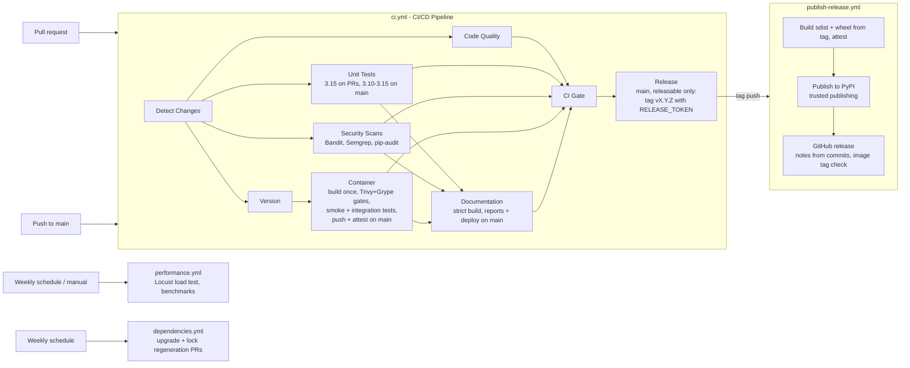

# Workflow Architecture

## Why it is shaped this way

- **One build per run.** The container image is built once and that build is scanned,
  smoke-tested, integration-tested and, on `main`, pushed. Earlier versions of the pipeline
  built it three times per run.
- **No bump commits.** The version is derived from the git tag, so a release is a tag push, not
  a pull request. That removes two full pipeline runs per release and the manual approval that
  used to be needed for the bump pull request.
- **Release only when something ships.** Documentation, CI and tooling merges are verified but
  do not produce a release.
- **Publish does not rebuild.** The tagged commit is the one the `main` run tested and pushed;
  the publish run builds the Python package from the tag and publishes it.
- **Performance tests are scheduled**, not on the merge path.

## Triggers

| Workflow | Trigger |
| --- | --- |
| `ci.yml` | pull requests to `main`; pushes to `main`; manual |
| `publish-release.yml` | tags `v*.*.*`; manual with a tag |
| `performance.yml` | Mondays 06:00 UTC; manual |
| `dependencies.yml` | Mondays 09:00 UTC; manual |

## Secrets and environment

- `RELEASE_TOKEN` (fine-grained PAT, Contents write) for the tag push.
- `pypi` environment (OIDC trusted publishing; branch `main` and tags `v*`).
- `GITHUB_TOKEN` read-only by default; jobs request what they need.

Mermaid node labels use ` ` line breaks; the site's Mermaid renderer keeps them legible.
